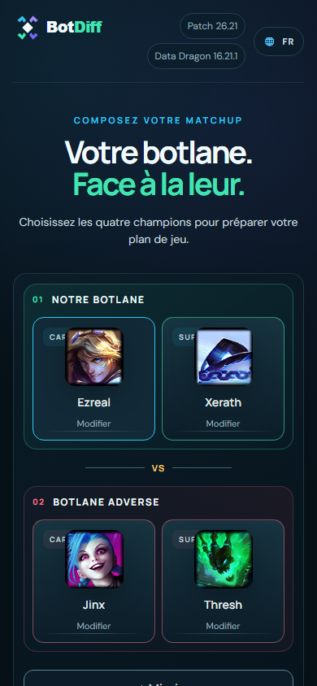
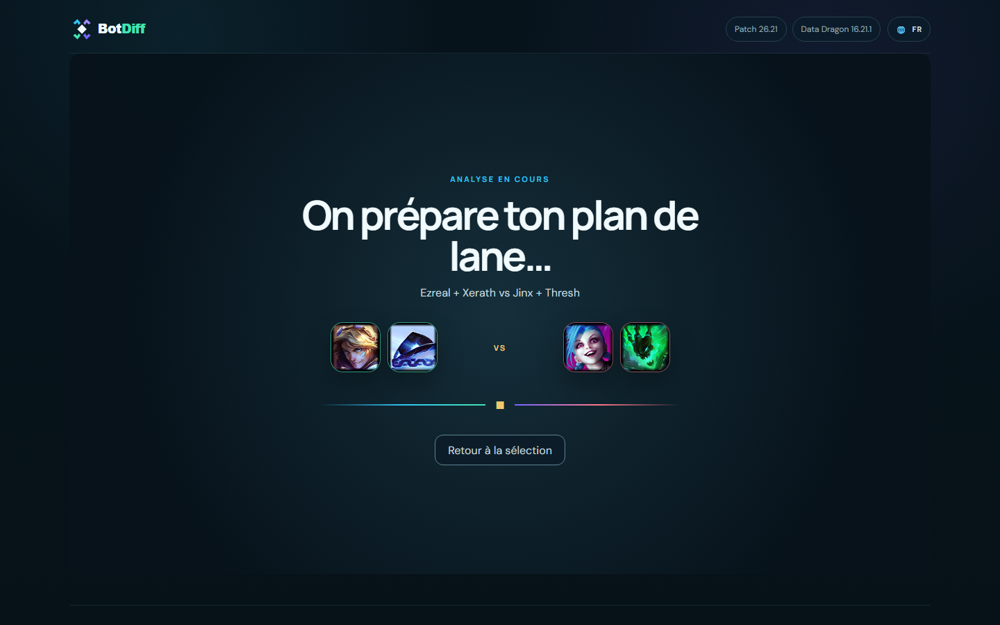
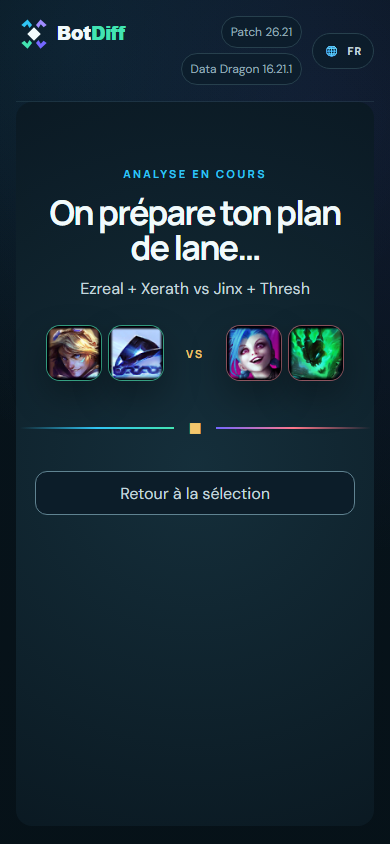
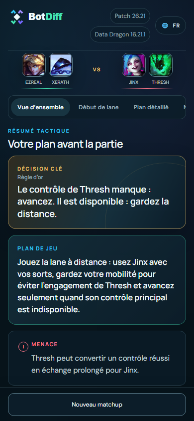

# BotDiff — Screenshots / Captures d'écran

[← BotDiff](../README.md)

Real alpha example: **Ezreal + Xerath vs Jinx + Thresh**. / Exemple réel de l'alpha.
This is an illustrative matchup, not a promise of complete coverage or infallible advice.

## 01 — desktop 1440 selection

## 02 — mobile 390 selection

## 03 — desktop 1440 chargement

## 04 — mobile 390 chargement

## 05 — desktop 1440 resultat

## 06 — mobile 390 resultat

## 07 — desktop 1440 details

## 08 — mobile 390 details

---

BotDiff is independent of Riot Games. League of Legends rights remain with their respective owners.
