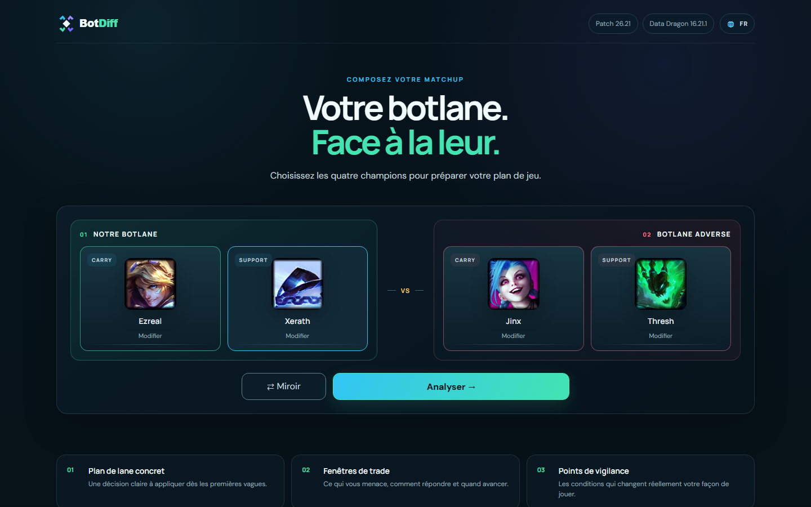
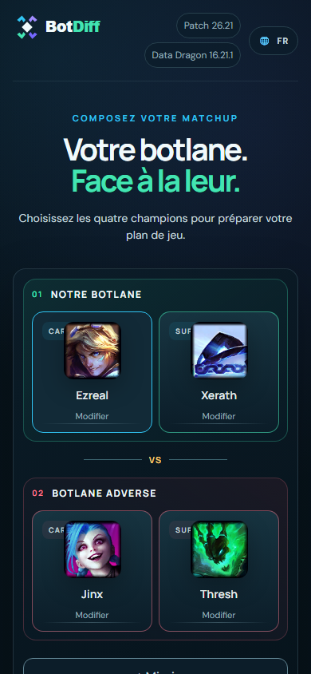
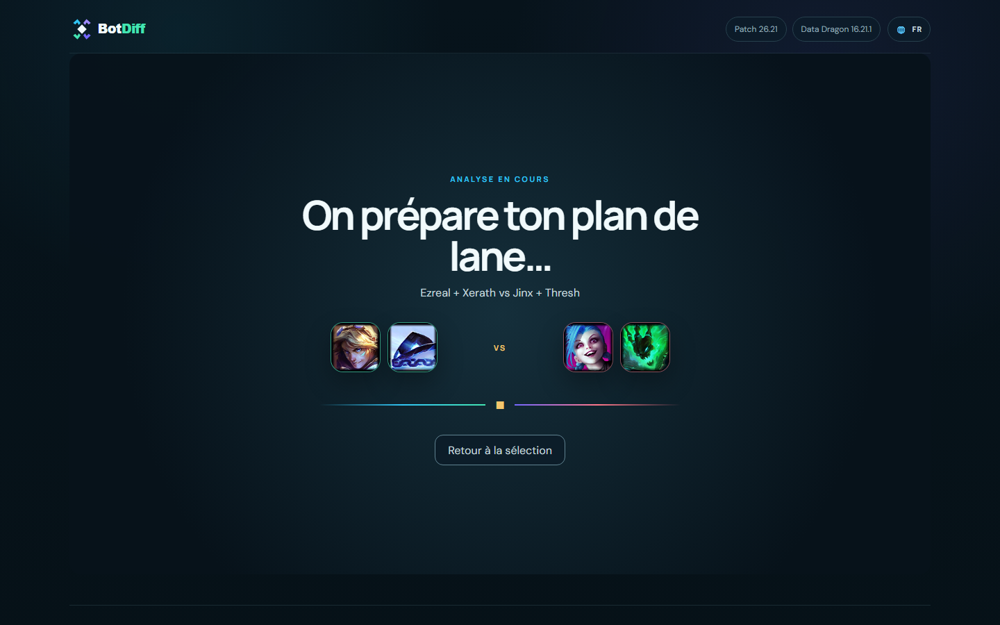
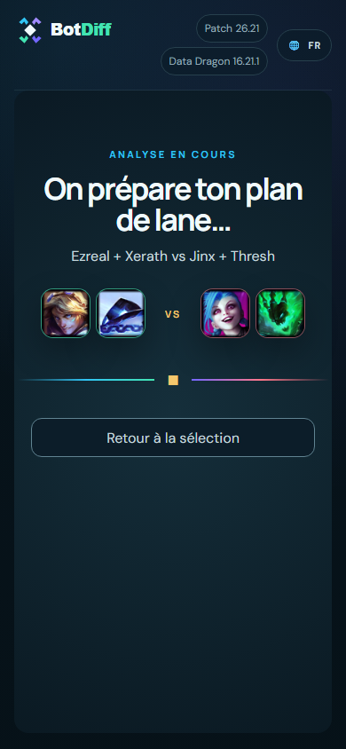
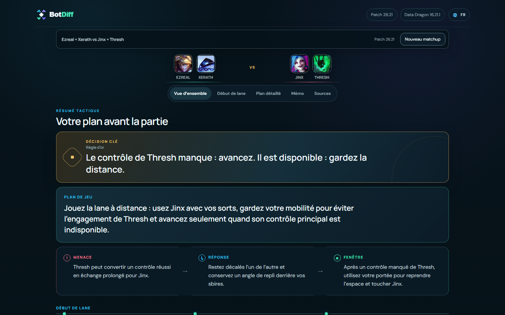
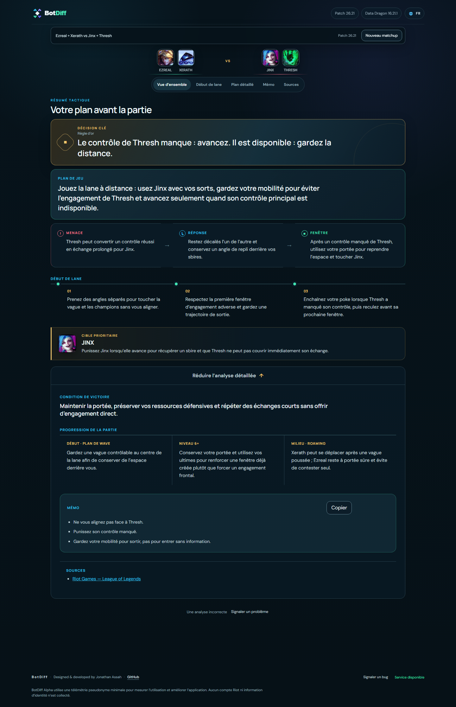
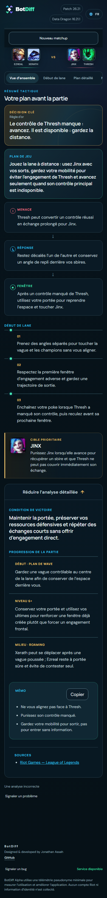

# BotDiff — Product screenshots / Captures d'écran

[← Back to BotDiff / Retour à BotDiff](../README.md)

A real example of the **Ezreal + Xerath vs Jinx + Thresh** matchup in the BotDiff alpha.
Each step is shown on **desktop (1,440 px)** and **mobile (390 px)**.

These screenshots illustrate one matchup. They do not imply perfect advice or universal analysis availability.

## 1. Choose your matchup / Sélection des champions

Select your ADC and support, then the opposing duo.

| Desktop | Mobile |
| :---: | :---: |
|  |  |

## 2. Generate the analysis / Chargement

A loading state while BotDiff prepares its matchup-specific guidance.

| Desktop | Mobile |
| :---: | :---: |
|  |  |

## 3. Read your lane plan / Résultat

A tactical overview to quickly understand the 2v2.

| Desktop | Mobile |
| :---: | :---: |
|  |  |

## 4. Explore tactical details / Détails

Dig deeper into decisions, risks and opportunities.

| Desktop | Mobile |
| :---: | :---: |
|  |  |

---

BotDiff is an independent third-party project, not endorsed by Riot Games. League of Legends game imagery and trademarks remain with their respective rights holders.
